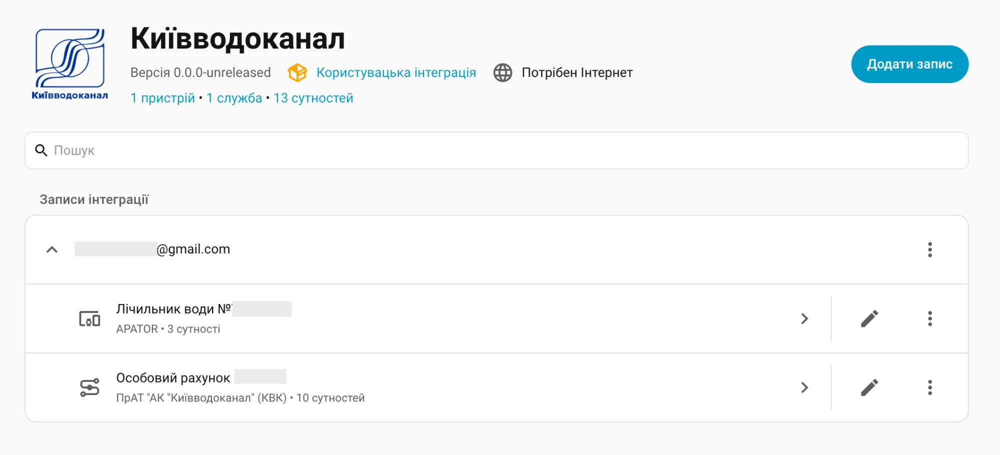

  

# 💧 Київводоканал для Home Assistant

[![GitHub Release][gh-release-image]][gh-release-url]
[![GitHub Downloads][gh-downloads-image]][gh-downloads-url]
[![hacs][hacs-image]][hacs-url]
[![GitHub Sponsors][gh-sponsors-image]][gh-sponsors-url]
[![Buy Me A Coffee][buymeacoffee-image]][buymeacoffee-url]
[![Twitter][twitter-image]][twitter-url]

[English](./readme.md) | [**Українською**](./readme.uk.md)

Показання лічильників води, рахунки, платежі й тарифи [Київводоканалу][kyivvodokanal] у [Home Assistant][home-assistant]. Споживання води можна додати до панелі «Енергія». Для підключення потрібні пошта й пароль від [Особистого кабінету][personal-account].

> [!NOTE]
> Інтеграція не пов'язана з [Київводоканалом][kyivvodokanal]. Її розробляє одна людина. Дані можуть відрізнятися від офіційного сайту.

## Спонсорство

Ваша підтримка допоможе мені розвивати й підтримувати більше таких проєктів.

- 💖 [Стати спонсором на GitHub][gh-sponsors-url]
- ☕️ [Підтримати на Buy Me A Coffee][buymeacoffee-url]
- Bitcoin: `bc1q7lfx6de8jrqt8mcds974l6nrsguhd6u30c6sg8`
- Ethereum: `0x6aF39C917359897ae6969Ad682C14110afe1a0a1`

## Встановлення

Додайте користувацький репозиторій у HACS, установіть інтеграцію та перезапустіть Home Assistant.

[![Додати до HACS][hacs-install-image]][hacs-install-url]

Додати репозиторій у HACS вручну

1. Відкрийте **HACS → ⋮ → Користувацькі репозиторії**.
2. Вставте `https://github.com/denysdovhan/ha-kyiv-vodokanal`, виберіть тип **Інтеграція**.
3. Завантажте **Kyiv Vodokanal** та перезапустіть Home Assistant.

Встановити без HACS

1. Скопіюйте `custom_components/kyiv_vodokanal` із цього репозиторію в `config/custom_components` вашого Home Assistant.
2. Перезапустіть Home Assistant.

## Використання

Натисніть кнопку та введіть пошту й пароль від [Особистого кабінету][personal-account]. Вхід через Google не підтримується.

[![Додати Київводоканал][install-image]][install-url]

Додати інтеграцію вручну

1. Відкрийте **Налаштування → Пристрої та служби → Додати інтеграцію**.
2. Знайдіть **Kyiv Vodokanal** і введіть пошту та пароль.

Для кожного лічильника води й кожного особового рахунку створюється окремий пристрій. Щоб додати інший обліковий запис, повторіть налаштування.

### Сенсори

Назви сенсорів збігаються з підписами в Особистому кабінеті.

#### Лічильник води №…

| Сенсор                 | Значення                                           |
| ---------------------- | -------------------------------------------------- |
| Останній показ         | м³; показ лічильника, джерело для панелі «Енергія» |
| Об'єм                  | м³; споживання за останній розрахунковий період    |
| Дата останнього показу | Розрахунковий місяць, до якого належить показ      |

#### Особовий рахунок …

| Сенсор                                                                      | Значення                                          |
| --------------------------------------------------------------------------- | ------------------------------------------------- |
| До оплати                                                                   | грн; сальдо на кінець останнього закритого місяця |
| Борг за попередні періоди                                                   | грн; неоплачений залишок попередніх місяців       |
| Нараховано                                                                  | грн; нарахування за останній закритий місяць      |
| Останній платіж, дата останнього платежу                                    | грн і дата; платежі за один день додаються        |
| Централізоване водопостачання (ХВ), Централізоване водовідведення (ГВ) (ХВ) | грн/м³; діючі тарифи                              |
| Вартість послуг                                                             | грн/м³; водопостачання й водовідведення разом     |
| Плата за абонентське обслуговування                                         | грн на місяць                                     |

У розділі **Діагностика**: час останньої успішної синхронізації.

### Панель «Енергія»

Відкрийте налаштування панелі «Енергія» й додайте джерело в розділі споживання води:

[![Відкрити налаштування енергії][energy-image]][energy-url]

1. Як джерело виберіть **Лічильник води №… Останній показ**.
2. Для вартості виберіть сутність з поточною ціною: **Особовий рахунок … Вартість послуг**.

Вартість — оцінка за діючим тарифом. Вона не враховує абонентську плату, водовідведення гарячої води та перерахунки. Фактичний рахунок показує сенсор **Нараховано**.

### Оновлення даних

- Опитування — кожні 6 годин. Показ зазвичай з'являється раз на місяць, коли його передасте ви, банк або Київводоканал.
- Місячне споживання потрапляє на панель «Енергія» однією сходинкою в момент появи нового показу. Денні та тижневі графіки неточні.
- Пароль зберігається в Home Assistant. Інтеграція сама входить повторно, коли сеанс закінчується. Якщо пароль змінився, Home Assistant попросить ввести новий.
- Новий лічильник або новий особовий рахунок з'являються автоматично після наступного оновлення.
- Інтеграція лише читає дані. Передача показів, оплата й повірка лічильників не підтримуються.

### Видалення

Відкрийте **Налаштування → Пристрої та служби → Kyiv Vodokanal** і видаліть запис через його меню. Після цього можна видалити інтеграцію в HACS або папку `config/custom_components/kyiv_vodokanal`.

## Розробка

Інструкції запуску й перевірок — у [contributing.md](./contributing.md).

## Інші інтеграції

- 💥 [Aerial Danger](https://github.com/denysdovhan/ha-aerial-danger) — повідомлення про повітряні загрози.
- ☁️ [Check Weather](https://github.com/denysdovhan/ha-check-weather) — перевірка погодних умов у прогнозі.
- ☀️ [Файна СЕС](https://github.com/denysdovhan/ha-fayna-ses) — акумулятори, потужність і енергія станцій Файна СЕС.
- 💨 [ЛУН Місто Air](https://github.com/denysdovhan/ha-lun-misto-air) — якість повітря.
- 🌦️ [УкрГідроМетЦентр](https://github.com/denysdovhan/ha-ukr-hmc) — погода, радіація та гідрологія.
- ⚡️ [Yasno](https://github.com/denysdovhan/ha-yasno-outages) — графіки відключень електроенергії.

## Ліцензія

MIT © [Денис Довгань][denysdovhan]

<!-- Badges -->

[gh-release-url]: https://github.com/denysdovhan/ha-kyiv-vodokanal/releases/latest
[gh-release-image]: https://img.shields.io/github/v/release/denysdovhan/ha-kyiv-vodokanal?style=flat-square
[gh-downloads-url]: https://github.com/denysdovhan/ha-kyiv-vodokanal/releases
[gh-downloads-image]: https://img.shields.io/github/downloads/denysdovhan/ha-kyiv-vodokanal/total?style=flat-square
[hacs-url]: https://github.com/hacs/integration
[hacs-image]: https://img.shields.io/badge/hacs-custom-orange.svg?style=flat-square
[gh-sponsors-url]: https://github.com/sponsors/denysdovhan
[gh-sponsors-image]: https://img.shields.io/github/sponsors/denysdovhan?style=flat-square
[buymeacoffee-url]: https://buymeacoffee.com/denysdovhan
[buymeacoffee-image]: https://img.shields.io/badge/support-buymeacoffee-222222.svg?style=flat-square
[twitter-url]: https://x.com/denysdovhan
[twitter-image]: https://img.shields.io/badge/follow-%40denysdovhan-000000.svg?style=flat-square

<!-- References -->

[home-assistant]: https://www.home-assistant.io/
[denysdovhan]: https://github.com/denysdovhan
[hacs-install-url]: https://my.home-assistant.io/redirect/hacs_repository/?owner=denysdovhan&repository=ha-kyiv-vodokanal&category=integration
[hacs-install-image]: https://my.home-assistant.io/badges/hacs_repository.svg
[install-image]: https://my.home-assistant.io/badges/config_flow_start.svg
[install-url]: https://my.home-assistant.io/redirect/config_flow_start/?domain=kyiv_vodokanal
[energy-image]: https://my.home-assistant.io/badges/config_energy.svg
[energy-url]: https://my.home-assistant.io/redirect/config_energy/
[kyivvodokanal]: https://vodokanal.kyiv.ua/
[personal-account]: https://my.vodokanal.kiev.ua/
